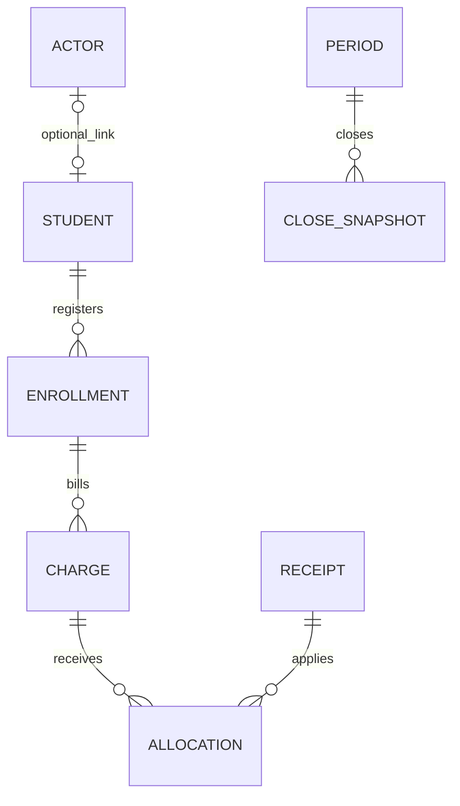

# TRYANGLE ERP 업무 계약 초안

작성 기준: 2026-11-25. 3단계 중 3.2 도메인 명세 초안이다. 운영 DB에는 코칭 학생 25건, 등록 1건, 수납·주문 0건이 있다. 앞으로 신규 사업·ERP 운영 범위는 매체연기다. 포지셔닝은 신규 운영하지 않고 기존 기록만 보존한다. 이 문서는 구현할 상태와 불변식을 정의하며 운영 스키마나 데이터를 변경하지 않는다. 운영 정책이 결정되지 않은 부분은 확정 사항으로 취급하지 않는다.

## 1. 식별자와 관계

| 개념 | 기준 키와 연결 규칙 | 현재 상태 |
|---|---|---|
| 학생 | 매체연기 학생의 `coaching_students.id`를 업무 식별자로 사용. 이름·연락처·생년은 중복 검토의 단서일 뿐 자동 병합 키로 사용하지 않는다. | 기존 학생 25건을 보존하며 새 매체연기 학생도 같은 원장에 등록한다. |
| 배우/계정 | `actor_id`는 선택 링크. 배우 데이터는 퍼스널 브랜딩 기록이며 학생 원장과 별개로 보존한다. | 코칭 학생의 actor 링크 0건. 기존 등록 1건에는 actor 링크가 있으나 코칭 학생과 연결되지 않는다. |
| 수강 등록 | `enrollment_id`는 한 번의 수강 계약/기간을 가리킨다. 재등록은 새 에피소드로 만들어 이전 기록을 보존한다. | `enrollments`에 학생 직접 FK는 없고 actor/문의/상담 선택 FK가 있다. 1건의 상품명·금액은 비어 있다. |
| 청구 | 수업 제공 기간·상품·확정 가격·납기를 가진 청구 항목. 계약 변경 시 발행된 청구를 덮어쓰지 않고 조정 항목을 남긴다. | 청구 원장 미확인. |
| 수납 | 확인된 입금/결제 이벤트. `receipt_id`와 중복 방지 키를 사용하며 청구 항목에 배분한다. | `payments`는 등록 FK를 갖지만 0건. 결제 주문도 0건이므로 기존 의미는 미확인. |
| 기간 | 한국 시간 기준 업무 월 `YYYY-MM`; 등록/청구/수납의 거래시각과 손익 귀속월을 따로 기록한다. | 월별 조회 화면만 있고 마감 원장은 미확인. |

**확정 식별 방향:** 신규 매체연기 수강 계약에는 `coaching_students.id`를 필수로 두고 actor/상담/문의 ID는 과거 이력과 연결할 때만 선택 참조로 유지한다. 기존 등록 1건은 자동 매칭하지 않고 검토 대상으로 표시한다. 포지셔닝 배우를 매체연기 학생으로 자동 전환하지 않는다. 동명이인과 연락처 변경 시 수동 병합 승인·이력 기록이 필요하다.

## 2. 상태 전이 초안

| 객체 | 허용 상태 흐름 제안 | 저장 시 검증 |
|---|---|---|
| 등록 | 신청 → 등록확정 → 일시중지 → 재개 또는 수료. 신청/등록확정에서 취소 가능 | 학생 ID, 상품·가격 스냅샷, 시작일. 수료/취소 이력을 유지. 재등록은 새 ID. |
| 청구 | 초안 → 발행 → 일부수납/완납. 발행 후 취소는 취소·조정 항목 | 통화, 귀속 기간, 양수/음수 조정 규칙. 잔액은 발행액과 유효 배분 합계로 계산. |
| 결제 주문 | 준비 → 대기 → 성공/실패/취소. 성공 후 환불 이벤트 가능 | 공급자 주문 ID의 유일성, 공급자 응답 검증, 같은 이벤트 중복 처리 방지. `checkout_orders`의 실제 운영 사용은 미확인. |
| 수납 | 접수 → 확인 → 배분. 환불/취소는 연결된 반대 거래 | 서버 확인 성공과 화면 표시 구분. 배분 합계는 확인 수납액을 초과하지 않는다. |
| 월마감 | 열림 → 검토중 → 확정. 재개방은 권한·사유·재확정 버전 필요 | 기간별 단일 활성 마감 버전, 집계 건수·금액 일치, 확정 후 원천 쓰기 차단. |

기존 `enrollments.status`의 실제 허용 값은 `applied/enrolled/paused/completed/cancelled`, `payments.status`는 `pending/paid/refunded/void`, `checkout_orders.status`는 `ready/pending/paid/cancelled/failed/refunded`다. 위 한국어 단계는 업무상 제안이며 기존 컬럼에 그대로 쓰는 값이 아니다. 환불 후 부분환불, 예약금, 선결제, 수업 취소와 보강의 처리 정책은 별도 확정이 필요하다.

## 3. 저장 API 계약 초안

| 작업 | 입력과 서버 동작 | 화면 결과 |
|---|---|---|
| 학생 연결 | 코칭 학생/배우의 명시적 ID, 관리자 식별자. 기존 링크 충돌을 확인하고 사유 기록 | 연결 성공 후 두 화면의 캐시 무효화 |
| 등록 생성 | 학생 ID, 상품/가격 스냅샷, 기간, 중복 방지 키. 서버에서 역할·유효성·중복 등록 검증 후 원자적 저장 | 저장 중 표시, 서버 성공 이후 확정, 실패 시 입력 유지 |
| 청구 발행 | 등록 ID, 제공월, 금액, 납기, 발행 근거. 같은 등록/월/항목의 중복 청구 규칙 검증 | 발행된 원장 ID 및 금액 표시 |
| 수납 확인 | 수납 이벤트 ID 또는 수동 입력 ID, 실수납액, 시각, 채널, 배분. 결제 공급자 확인/수동 승인 후 단일 트랜잭션으로 기록 | 즉시 ‘처리 중’ 표시 가능. 서버 확정 전 ‘완료’로 표시 금지 |
| 환불·정정 | 원거래 ID, 사유, 금액, 승인자. 원거래 보존 및 반대 이벤트 기록 | 잔액과 감사이력 갱신. 실패 시 화면 복구 |
| 마감 확정 | 업무 월, 기대 버전, 승인자. 합계 검증과 잠금/스냅샷을 원자적으로 처리 | 새 버전과 확정 시각 반환. 재시도는 중복 확정을 만들지 않음 |

모든 쓰기 API는 서버에서 관리자의 세션과 **작업별 역할**을 확인한다. 서비스 역할 키를 쓰는 서버 경로는 RLS를 우회할 수 있으므로 DB 마감 잠금 규칙을 함께 강제해야 한다. 결제·청구·마감 쓰기의 감사 기록은 실제 업무 처리와 같은 원자적 단위로 남긴다. 현재의 best-effort `audit()`만으로 대체하지 않는다.

## 4. 권한 초안

| 역할 | 학생/일정 | 청구/수납 | 환불·정정 | 월마감/재개방 |
|---|---|---|---|---|
| 조회 관리자 | 조회 | 조회 | 조회 | 확정본 조회 |
| 운영 관리자 | 입력·수정 | 청구 초안 | 불가 | 불가 |
| 결제 담당 | 조회 | 발행·수납확인 | 승인 범위 내 처리 | 조회 |
| 마감 책임자 | 조회 | 조회·대조 | 승인 | 확정·통제된 재개방 |

이는 미래 역할 설계다. 현행 관리자 계정에 이 역할들이 구현되어 있다는 의미가 아니다. 한 사람이 여러 역할을 가질 수 있으나, 본인 거래의 환불 승인이나 마감 재개방 같은 분리 원칙은 운영 인원에 맞춰 정한다.

## 5. 성능 계약과 관측

- 학생/등록/청구 목록: 서버 페이지네이션, 필터·정렬용 인덱스는 실행계획을 보고 설계. 첫 화면에서 이력 전체를 가져오지 않는다.
- 학생 상세: 학생 기본정보를 먼저 보여주고 수강/결제/출결 탭은 진입 시 조회. 독립 요청은 병렬 처리하되 동일 데이터 중복 조회를 피한다.
- 월 손익: 등록 행과 학생 행을 브라우저로 전송해 합산하지 않고 서버/DB의 기간별 집계를 이용한다. 마감 확정본은 버전별 재사용한다.
- 사용성 목표: 메뉴 0.3초 이내 체감 반응과 결제 서버 확정 1초 이내를 별도로 측정한다. 현재 실측이 없으므로 예상 개선 수치는 기재하지 않는다.
- 학생 100/500/1,000명 시나리오: 페이지당 행 수를 일정하게 유지하고 등록·청구·수납 이력 건수 증가에 따른 쿼리 시간과 호출 횟수를 비교한다. 인덱스/집계 최적화 후에만 추가 캐시나 외부 저장소를 검토한다.

## 6. 구현 전 결정과 이행 순서

1. 매체연기 학생은 `coaching_students`로 관리한다. 신규 포지셔닝 등록 경로는 ERP 범위에서 제외하고 기존 배우·리서치 이력은 보존한다.
2. 가격/수익 인식: 주 1·2회, 1:1·소그룹, 선결제, 중도 시작, 환불과 보강의 귀속월을 확정한다.
3. 기존 등록 1건의 생성 주체와 의미를 확인하고 수동 연결 여부를 결정한다. 이름·연락처로 자동 병합하지 않는다.
4. 상품/등록/청구/수납 관계의 스키마 변경안을 추가형 마이그레이션으로 작성한다. 신규 FK는 기존 1건의 검증 경로를 마련한 후 필수화한다.
5. 읽기 경로와 기존 월 합계를 먼저 대조하고, 수납 저장은 관리자 권한과 중복 방지·복구를 검증한 뒤 활성화한다.
6. 월마감 정책과 Sheets 확정 합계 형식을 정한 다음 월별 잠금과 내보내기를 구현한다.

결정이 필요한 정책은 사용자와 실제 업무 흐름으로 확정해야 한다. 지금 단계의 상태표·API 계약은 구현 기준을 검토하기 위한 제안이다.
