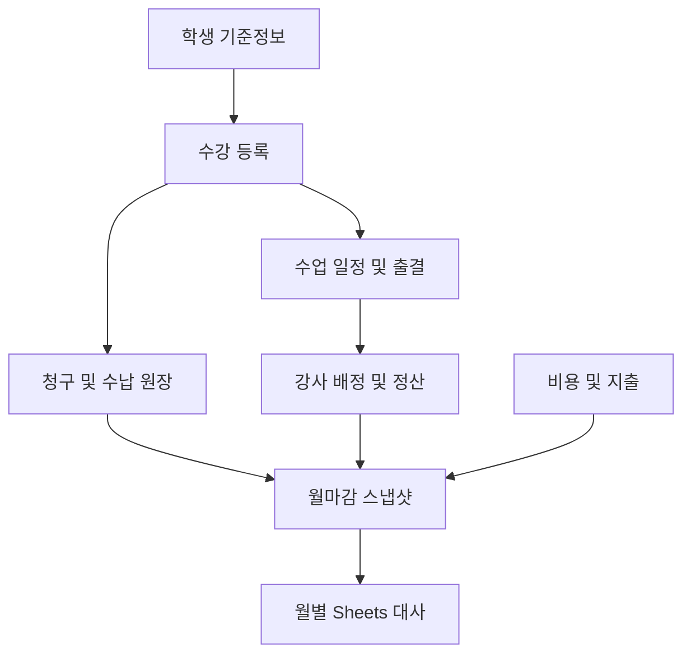

# TRYANGLE ERP 3단계 설계안

작성 기준: 2026-11-25. 이 문서는 현재 확인한 저장소와 운영 구조를 바탕으로 한 설계 및 실행계획이다. 이번 단계에서는 운영 코드, Supabase 스키마·데이터·보안정책, Vercel 배포를 변경하지 않는다.

## 1. 확인된 현재 상태와 설계 원칙

- 어드민은 Next.js 기반이며 Vercel에 배포되고, 업무 데이터는 Supabase PostgreSQL에 저장되는 구조다.
- 현재 `coaching_students`를 포함한 상담·학생 관련 테이블과 `enrollments`, `payments`, `checkout_orders`가 존재한다. 상담·학생 흐름은 일부 구현되어 있지만 완결된 회계원장·시간표·월마감 구조는 확인되지 않았다.
- `payments`는 등록(enrollment)에 연결되어 있으나, 청구금액·수납 배분·환불/정정의 전체 원장 흐름이 확인되지 않았다. 기존 의미를 먼저 데이터 표본과 화면/API 사용처로 확정해야 한다.
- 현재 운영 화면은 월별 결제와 마케팅 지출 등 기초자료를 조회한다. 시간표는 미연결 상태를 표시하며, 월마감 상태도 확정되지 않은 상태다.
- 저장소 내 결제 테이블 사용처를 추적한 결과, 현재 확인되는 `payments` 사용은 월별 결제 기록 조회다. `src/app/admin/actions.ts`의 `conversion_payment_complete`는 상담 메모에서 전환 이벤트를 감사로그로 남기는 것으로, 결제 원장 저장으로 볼 수 없다.
- 저장소 검색에서 `checkout_orders`와 `enrollments`의 직접 API 사용/쓰기 경로는 확인되지 않았다. 실제 데이터 건수는 아래 운영 DB 집계로 확인했으나 쓰기 주체는 미확인이다.
- `coaching_students`는 학생 CRUD·보관처리의 현재 대상이다. `actor_id`는 선택 연결이며 고유 인덱스로 배우와 코칭 학생의 중복 링크를 막는다. 배우에서 코칭으로 연동 시 배우의 일부 기본값을 복사하고, 이후 연결을 끊어도 코칭 행은 보존한다.
- `admin_audit_log`는 관리자 식별자와 상세 JSON을 기록하는 코드가 있지만, 로깅 실패가 본 작업을 막지 않도록 설계되어 있다. 따라서 이를 회계 원장이나 강제적인 정합성 통제로 간주하면 안 된다.
- Google Sheets API 연동은 저장소에서 확인되지 않았다. 향후 Sheets는 월별 확정 실적의 대사·보조 분석용으로만 두고 학생 원장이나 결제 원천으로 사용하지 않는다.
- Vercel 운영 지표 및 배포 세부 정보 일부는 접근 제한으로 확인되지 않았다. 무료 요금제 유지가 전제이며, 추가 유료 서비스 도입은 측정 후 별도 검토한다.

### 운영 Supabase 읽기 전용 점검 (2026-11-25)

대상은 `tryangle-personal-research` 프로젝트다. 테이블 구조와 소량의 집계 SQL만 확인했고 개인별 이름·연락처·결제 정보는 추출하지 않았다.

| 테이블 | 실제 건수 | 확인된 연결 |
|---|---:|---|
| `coaching_students` | 25 | `actor_id`가 있는 행 0건, 보관 상태 1건 |
| `enrollments` | 1 | `actor_id`가 있는 행 1건, 코칭 학생과 같은 actor로 연결되는 행 0건 |
| `payments` | 0 | 등록을 참조하는 외래키가 있으나 실제 수납 기록 없음 |
| `checkout_orders` | 0 | 등록·actor 선택 연결이 있으나 실제 주문 기록 없음 |

`enrollments`의 유일한 행은 `product_name`과 `amount`가 비어 있다. 등록의 actor·문의·상담 참조 중 존재하는 값에 대해 고아 참조는 0건이고, 참조 셋이 모두 빈 등록도 0건이다. 코칭 학생의 actor 참조 고아 건수도 0건이다. 이 결과는 현재 시점의 작은 표본에 한정된다. 외래키와 RLS는 네 테이블에 적용되어 있지만, 세부 접근 정책과 외부 결제 생성 주체는 이 점검만으로 확인되지 않는다.

**설계 영향:** 코칭 학생 25건을 기존 등록 1건과 자동으로 결합할 키가 현재 데이터에서 확인되지 않는다. 학생 등록/재등록 기능은 학생 식별자 연결 방식을 먼저 정해야 하며, 빈 결제 테이블에 근거해 실거래 환불·정산 흐름이 이미 작동한다고 가정해서는 안 된다.

원칙은 Supabase를 중앙 원장으로 유지하고, 모든 매체연기 업무 입력은 어드민에서 수행하는 것이다. 포지셔닝은 신규 운영하지 않으며 기존 배우·리서치 기록만 보존한다. 기존 데이터는 삭제·대량 재작성하지 않는다. 새 구조는 우선 기존 테이블과 병행해 읽기 전용 매핑·대조를 거친 다음, 단계적으로 전환한다.

## 2. 목표 업무 데이터 흐름

## 3. 목표 데이터 모델

| 업무 | 목표 개념 | 설계 기준 및 현행 연결 |
|---|---|---|
| 학생 | 매체연기 학생과 선택적 과거 actor 연결 | `coaching_students.id`를 신규 수강의 학생 식별자로 사용한다. 포지셔닝 actor는 기존 이력으로 보존하고 자동 병합하지 않는다. |
| 수강 | 등록 회차(enrollment)와 상품/요금 조건 | 원격 테이블의 존재는 확인됐지만 저장소 코드에서 사용 경로가 확인되지 않았다. 기존 `enrollments`를 바로 등록 원장으로 쓰기 전에 실제 데이터 및 외부 쓰기 주체를 검증한다. |
| 시간표 | 수업 일정, 강의실, 강사 배정 | 일정 단위의 충돌 검사와 취소/보강 이력을 남긴다. 반복 시간표 정의와 실제 수업 회차는 개념을 분리한다. |
| 청구 | 등록별 청구서/청구 항목 | 월 수강료와 서비스 제공 기간, 납기, 금액을 보존한다. 청구와 수납을 같은 행의 상태값만으로 처리하지 않는다. |
| 수납 | 수납 거래 및 청구 배분 | 저장소에서 `payments` 쓰기 경로는 확인되지 않았고 월별 조회만 보인다. `checkout_orders`도 저장소 사용처가 발견되지 않았다. 실제 데이터, 외부 결제 연동/수동 입력 주체, 상태 의미를 확인한 뒤 append-only 원장과 청구 배분 전환을 설계한다. |
| 강사/정산 | 강사, 배정, 정산 기간 및 정산 항목 | 수업 회차와 정산 항목의 근거를 연결한다. 지급 확정 뒤 변경은 사유와 승인 이력을 남긴다. |
| 비용/손익 | 비용 분류와 귀속월 | 현재 마케팅 지출 자료를 포함해 실제 비용 원천을 점검한다. 귀속월, 증빙 참조, 분류, 수정이력을 보존한다. |
| 감사 | 행위자·대상·변경 전후·사유 | 현재 코드가 관리자 ID/account ID와 요약·상세 JSON을 기록한다. 기록 실패는 본 작업을 막지 않으며 일반적인 학생/결제 수정 전후 스냅샷 및 사유 필수화는 확인되지 않았다. 정합성 통제로 격상하려면 원자적 저장 경로를 별도 설계한다. |
| 월마감 | 기간 상태와 확정 스냅샷 | 기간별 open/closing/closed 상태, 확정자·시간, 집계 기준 버전을 기록한다. 닫힌 기간의 원천 데이터 변경은 DB 측에서도 차단하고, 정정은 권한 있는 재개방 또는 다음 기간 조정전표 흐름으로 처리한다. |
| Sheets 대사 | 내보내기 실행 및 합계 대조 | 마감 버전·내보낸 합계·행 수·실행 상태·재시도 키를 기록한다. 필요한 월별 확정 합계만 전달하고 학생 개인정보는 기본 제외한다. |

정확한 테이블/컬럼명과 제약조건은 설계 확정 후 별도의 마이그레이션 명세에서 정한다. 이 문서 단계에서는 SQL을 실행하지 않는다.

## 4. 결제·회계 정합성 및 마감 통제

1. 결제 저장은 화면의 낙관적 표시와 서버의 확정 응답을 분리한다. 성공 응답 전에는 확정 상태로 표시하지 않는다.
2. 저장 요청에는 중복 제출 방지 키를 두고, 동일 결제 웹훅/요청이 재전송되어도 원거래가 중복 생성되지 않게 한다.
3. 등록, 청구, 수납 배분, 상태 갱신처럼 함께 성공해야 하는 작업은 DB 트랜잭션 또는 단일 원자적 서버 작업으로 묶는다.
4. 삭제 대신 취소·환불·정정 이벤트를 기록하고 원거래를 참조한다. 결제 원천 응답은 필요한 최소 범위와 보존정책을 정해 안전하게 다룬다.
5. 월마감 시 원천 집계의 건수와 금액, 계산 버전, 확정 시각·관리자를 스냅샷으로 보존한다. 마감 후 원천 수정은 서버 권한검사뿐 아니라 DB 함수/제약 등 우회 불가능한 통제로 보호한다.
6. 관리자 인증만으로 모든 관리 행위가 허용되지 않도록 역할을 구분한다(입력, 결제/정정, 마감, 재개방). 최소 권한을 적용하고 감사로그에 변경 사유를 남긴다.

## 5. 성능·확장 설계

- 학생·결제 목록은 서버 페이지네이션과 서버 측 필터를 기본으로 하고 필요한 열만 선택한다.
- 대시보드와 월 손익은 원천 행 전체를 내려받지 않고 기간·상태 조건을 포함한 DB 집계 쿼리로 계산한다.
- 독립 조회는 서버에서 병렬 처리하되, 필요한 요청만 실행한다. 이미 수행된 1·2단계의 중복 조회 제거와 목록 최적화를 유지한다.
- 캐시는 조회 데이터에만 적용하고, 결제·회계 저장 후에는 관련 키를 무효화한다. 회계 값의 장기 캐시로 화면과 원장이 달라지지 않게 한다.
- 인덱스는 실제 필터/정렬 및 `EXPLAIN (ANALYZE, BUFFERS)` 결과를 근거로 추가한다. 운영 대량 부하 테스트 대신 스테이징 또는 낮은 부하의 표본 조회를 사용한다.
- 월 집계는 먼저 적절한 SQL 집계와 인덱스로 처리한다. 측정상 병목이 확인된 경우에만 요약 테이블 또는 Materialized View를 검토한다.
- 학생 100/500/1,000명 규모 자체는 현재 PostgreSQL 구조에서 일반적으로 큰 데이터량이라고 단정할 수 없다. 실제 병목은 목록의 무제한 조회, 조인/집계, 요청 수, 이미지/외부 API, 인덱스 및 서버-DB 왕복 지연에서 먼저 생길 가능성이 있다. 현재 데이터량의 실측 응답시간은 미확인이다.
- 현재 무료 요금제 전제에서는 Redis나 별도 백엔드를 추가하지 않는다. 먼저 쿼리 수, 페이로드, 렌더링, 캐시 적중률을 측정한다.

## 6. 단계별 실행계획

| 순서 | 작업 | 완료 조건 | 위험/주의 |
|---|---|---|---|
| 3.1 현행 의미 확정 | 저장소상 `coaching_students` CRUD 및 월별 `payments` 조회를 확인했다. 원격 DB의 건수와 actor/문의/상담 참조를 점검했다. 다음은 결제·등록의 외부 쓰기 주체와 학생 식별 정책 확정이다. | 위 집계 확인 완료. 업무 용어·상태전이 및 운영 입력 주체는 미확인 | 결제/주문 데이터 0건이므로 실거래 흐름은 검증할 수 없다. |
| 3.2 도메인 명세 | 학생-등록-청구-수납-배분-환불-마감 관계와 역할 권한을 확정한다. 시간표·강사·비용 모델도 범위 정의한다. | ERD, API 계약, 접근통제표, 보존정책 | 요구사항과 기존 코드 사이 호환성 확인 필요 |
| 3.3 안전한 스키마 이행안 | 기존 데이터를 보존하는 additive migration, backfill, 검증 쿼리, 롤백 절차를 작성한다. | 검토 가능한 migration PR 및 백업/복구 절차 | 월마감·원장 규칙은 회계 담당 검토 선행 |
| 3.4 스테이징 시범 | 가명/복제 데이터로 신규 흐름을 병행 실행하고 기존 합계와 대조한다. 결제 중복, 부분 실패, 권한 우회를 점검한다. | 합계 일치, 감사 추적, 복구 리허설 통과 | 운영 적용 전 사용자 승인 및 배포 계획 필요 |
| 3.5 기능별 전환 | 먼저 읽기 화면과 집계를 바꾸고, 이후 등록/청구/수납/정산을 순차 전환한다. 구버전 비교 기간을 둔다. | 기능별 검증·관측 지표 충족 | 일괄 전환 금지, 문제가 있으면 이전 읽기 경로로 복귀 |
| 3.6 월마감과 Sheets | 확정 스냅샷을 만들고 요약 데이터만 Sheets로 내보내어 건수·금액 대조 및 재시도 기록을 제공한다. | 반복 실행에도 중복 없이 대사 가능 | Sheets는 Supabase 원장을 덮어쓰지 않음 |

## 7. 성능 확인 기준

목표 수치(최초 표시 1.5초, 메뉴 전환 0.3초 체감, 검색 0.5초, 결제 저장 1초, 일반 조회 1초)는 사용자 경험 목표로 유지한다. 화면 반응과 서버 확정 시간은 각각 기록한다. 현재 각 기능의 실제 지연시간은 측정되지 않아 개선률을 수치로 예측하지 않는다.

스테이징에서 기능별로 브라우저 네트워크 타이밍, 서버 함수 총시간, Supabase 쿼리 수·실행시간, 렌더 완료 시점을 함께 측정한다. 로그인, 대시보드, 학생 목록/검색, 저장/결제 변경, 탭 이동, 월 집계를 별도 시나리오로 나누고 데이터 건수·캐시 상태·지역·기기·반복 횟수를 기록한다. 운영 측정은 정상 사용 트래픽 관찰 중심으로 하고 부하 테스트를 피한다.

## 8. 다음 구현 전 의사결정 항목

- `enrollments` 1건의 생성 경로와 `payments`·`checkout_orders` 향후 쓰기 주체 확인
- `payments`의 상태·금액·결제일 의미와 `checkout_orders`의 결제 성공/취소 상태 동기화 규칙 확인
- 기존 포지셔닝 actor가 매체연기로 전환을 요청할 때의 수동 연결·이력 보존 규칙 확정
- 수강료 선결제/월별 청구, 환불 및 결석·보강의 회계 처리 정책 확정
- 마감 후 정정 방식(권한 있는 재개방 또는 다음 달 조정)과 승인자 확정
- 강사 정산 기준과 Google Sheets 월별 확정 양식/합계 정의
- 역할별 관리자 권한 및 감사로그 보존기간 확정

이 결정 전에는 회계 원장 테이블을 새로 만들거나 기존 결제 상태를 일괄 변환하지 않는다.
